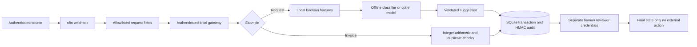

# Secure n8n automation examples

Two runnable reference projects by Kevin Mast / KAI Automation Systems: **request triage with a constrained model boundary** and **invoice validation with human approval**.

Built as new portfolio demonstrations for conversations with automation agencies. These are **not historical client deliveries**, not a compliance certification, and not a ready-to-expose SaaS service. Synthetic examples only. See [German overview](PORTFOLIO_DE.md).

## What the examples demonstrate

**Request triage** accepts a subject and message, derives three local boolean signals, and suggests a queue and priority. Raw messages never reach the model provider or database. The model cannot call tools, choose URLs or approve a record. Invalid output and provider failures go to manual review. A human must approve before the job becomes approved. No email is sent.

**Invoice review** validates a small structured invoice envelope using integer cents, enforces net + tax = gross and EUR, prevents repeated processing and duplicate supplier/invoice pairs, and requires two different reviewer identities for amounts of EUR 1,000 or more. There is no payment integration and no legal/tax-compliance assessment.

The shared gateway owns validation, durable state, deduplication, approval transitions and audit events. n8n owns orchestration. This keeps security-sensitive state transitions out of editable workflow expressions and makes them independently testable.



## Run in two minutes

Python 3.11+ and Node.js 20+ for the workflow tests. The Python service uses the standard library only. No pip installation or API key is needed for the offline demo.

```sh
python -m unittest discover -v
node --test tests/workflows.test.mjs
python -m automation.demo
```

The demo uses a temporary database and synthetic inputs. Expect `pending_review` for triage, then `awaiting_second_review` and `approved` for the invoice. The offline classifier is deterministic; this run does not test a live LLM.

## Start the local gateway

From the repository root in PowerShell:

```powershell
python scripts/configure_demo.py
. ./var/secrets.ps1
python -m automation.server
```

Four separate secrets are generated without being printed. Restrict `var/secrets.ps1` and `var/` to your own OS account. Windows ACLs, disk encryption and backup permissions remain operator responsibilities. Do not reuse tokens from other projects. The file is ignored by Git.

In a second PowerShell session:

```powershell
. ./var/secrets.ps1
$headers = @{ Authorization = "Bearer $env:INGEST_TOKEN" }
$body = @{event_id='request-demo-001';subject='API Fehler';body='Synthetische Anfrage: der Workflow hat einen Fehler.'} | ConvertTo-Json
$job = Invoke-RestMethod http://127.0.0.1:8080/v1/intakes -Method Post -Headers $headers -ContentType application/json -Body $body
$review = @{ Authorization = "Bearer $env:REVIEWER_A_TOKEN" }
Invoke-RestMethod "http://127.0.0.1:8080/v1/jobs/$($job.id)/decision" -Method Post -Headers $review -ContentType application/json -Body '{"decision":"approve"}'
```

See [API and sample invoice](docs/API.md). Reviewer identity comes from the token, never from a supplied actor field. The two tokens represent two demo reviewers; proper identity lifecycle/SSO is a production integration task.

## Import into n8n

Import [request triage](workflows/intakes.json) and [invoice review](workflows/invoices.json). They are inactive and contain **no credentials**, credential IDs, real data or pinned output.

Run n8n **natively on the same host as the gateway**, not in a separate container: the HTTP Request URL is deliberately fixed to `http://127.0.0.1:8080`. A Docker installation needs a deliberately reviewed network design and different fixed URL; don't substitute input-supplied destinations.

Create two n8n Header Auth credentials:

1. Source authentication: header `X-Webhook-Token`, a newly generated secret different from all gateway secrets. Assign to `Authenticated request`.
2. Gateway ingest authentication: header `Authorization`, value `Bearer <INGEST_TOKEN>`. Assign to `Submit for review`.

Never put reviewer tokens or `AUDIT_KEY` into n8n. Use synthetic data with the test webhook, then activate deliberately. Set `N8N_PAYLOAD_SIZE_MAX=1`, `N8N_DIAGNOSTICS_ENABLED=false`, `EXECUTIONS_DATA_SAVE_ON_SUCCESS=none`, `EXECUTIONS_DATA_SAVE_ON_ERROR=none`, and `EXECUTIONS_DATA_SAVE_MANUAL_EXECUTIONS=false`. Workflow settings also disable saved execution payloads. Existing manual executions and instance-level logs must be checked separately. The first Code node discards webhook headers; it cannot erase data captured elsewhere by the instance or infrastructure.

The webhook returns the gateway status, including 409 for conflicts and 422 for invalid input. Invalid field sets fail in the Code node before gateway processing. Transport errors fail the workflow; retries must retain the same `event_id`. A successful ingest response means **queued for review**, not approved or sent. Service-to-service timeouts and durable idempotency handle retries; there is no hidden automatic email or payment action.

## Optional live model

The invoice example never calls a model. For request triage, set `MODEL_MODE=anthropic`, `ALLOW_EXTERNAL_MODEL=true`, `ANTHROPIC_API_KEY` and `ANTHROPIC_MODEL` explicitly in the gateway environment. Use an account-approved currently available model ID. Only three booleans leave the gateway. The adapter has a fixed HTTPS host, no redirects or proxy-environment inheritance, an eight-second timeout, bounded response reading and strict output validation. No automatic retries/cost loop.

This deliberately small classification task is also solvable without AI. The point is to show the boundary and safe failure handling, not to force an LLM into deterministic business rules. The offline classifier is the preferred default. No claim of live-provider testing is made without a recorded real call.

## Security and data protection

Read [SECURITY.md](SECURITY.md) for trust boundaries, negative tests, what is protected and what is not. Read [data handling](docs/DATA_HANDLING.md) before enabling external processing or changing retention. HMAC audit signatures detect modified records but **cannot detect deletion, truncation or an administrator with the key**. There is no assertion of GDPR compliance, legal privilege, immutable archiving or legal/tax correctness.

## Repository layout

- `automation/`: independently executable gateway and business rules.
- `workflows/`: two n8n imports; regenerate using `python scripts/build_workflows.py`.
- `tests/`: Python transaction/HTTP/adversarial tests and executable n8n Code-node tests.
- `docs/`: API, data handling and validation record.
- `.github/workflows/ci.yml`: least-privilege checks, including export reproducibility.

No commercial affiliation with KI Kanzlei, n8n, Anthropic or any invoice supplier is implied.
